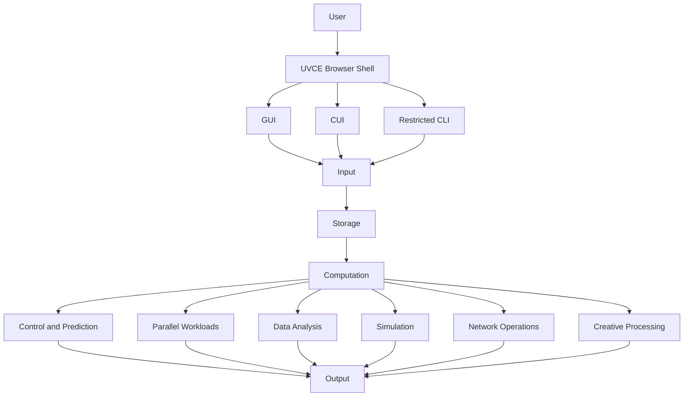
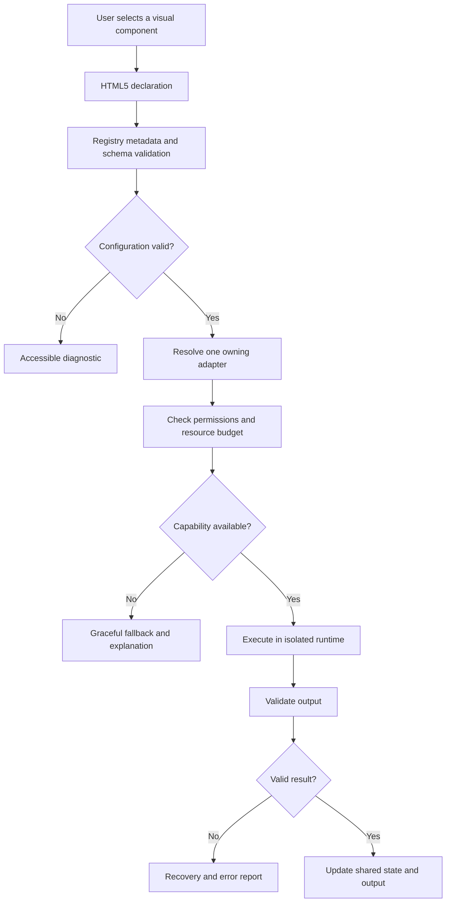
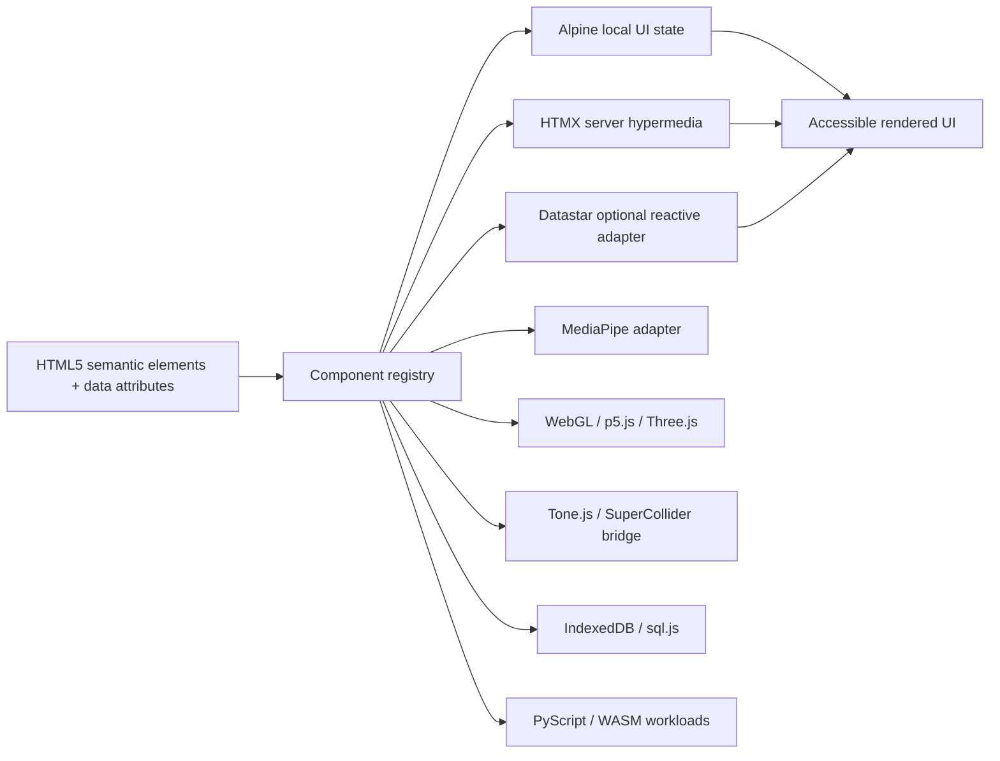
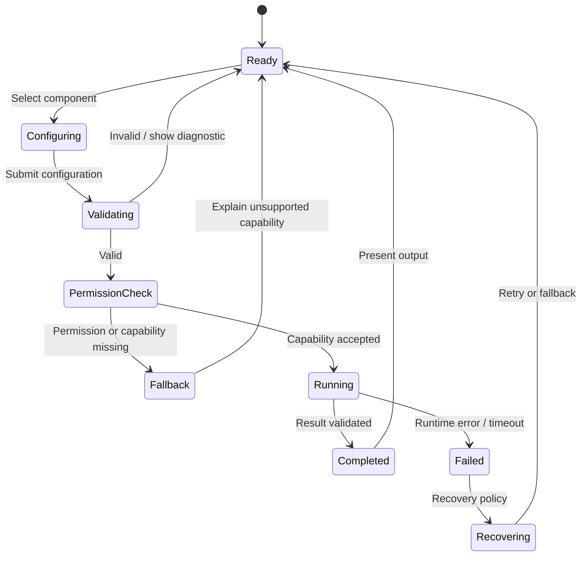
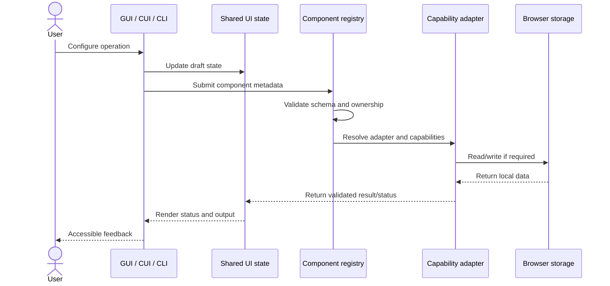
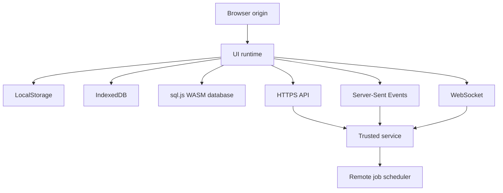
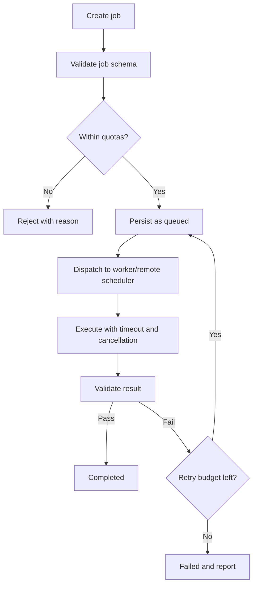
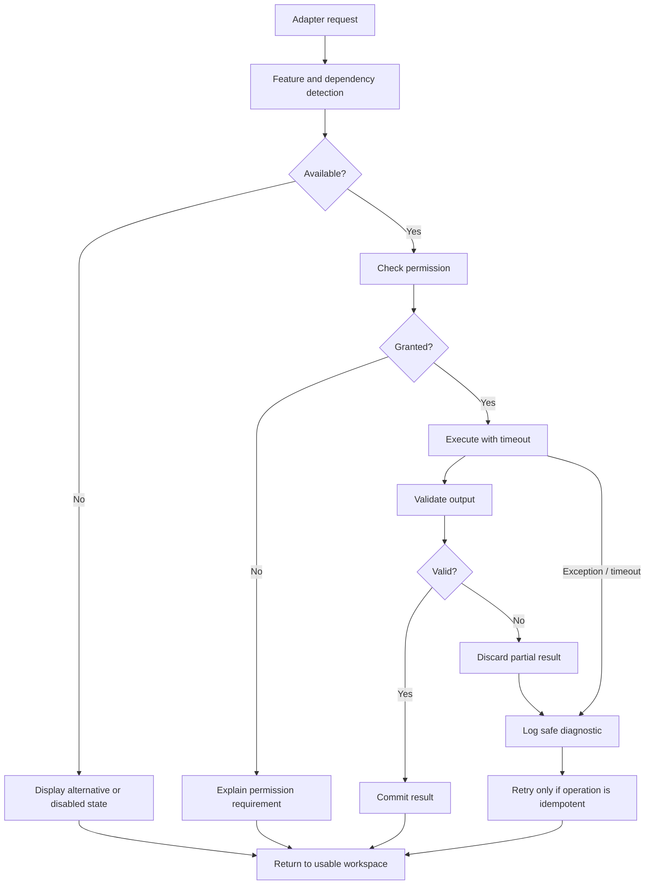

# Universal Visual Computing Environment (UVCE)

**Project type:** Visual-first browser workspace / virtual desktop prototype  
**Version:** 0.1.0  
**Initial project files:** exactly two  
**Primary document:** `/index.html`  
**Documentation:** `/README.md`  
**UI languages:** English and Japanese

UVCE is a declarative HTML5-first workspace concept that organizes browser-accessible computing into four layers: **Input → Storage → Computation → Output**. The prototype combines a desktop-style GUI, a guided CUI, a restricted CLI, a local job queue, persistent preferences, a calculator, a component catalogue, and a technology integration strategy.

> **Scope and honesty:** this is a functional browser-interface prototype, not a complete native operating system, hypervisor, general-purpose virtual machine, distributed supercomputer, or production creative suite. Local preferences and the calculator work in the browser. Job execution is a labelled demonstration simulation. Camera, microphone, advanced graphics, media processing, databases, remote services, and native OS operations need separately implemented and permissioned adapters. HTML attributes do not replace the execution semantics of JavaScript, Python, PHP, SQL, WebAssembly, or native operating systems.

---

## 1. Project structure

```text
/
├── index.html   # Complete UI, declarative component markup, Alpine state and local demo logic
└── README.md    # Architecture, technology inventory, algorithms, setup, security and operations
```

No local `.js`, `.css`, model, worker, WASM, image, or configuration files are required by this prototype. Runtime libraries are referenced from CDNs. This reduces setup friction but means the page depends on network access and third-party availability. For production, pin and self-host reviewed dependencies, implement a Content Security Policy, and test a reproducible release build.

## 2. Run the application

### Option A — open the HTML file

1. Save the files at `/index.html` and `/README.md` in the same directory.
2. Open `index.html` in a current desktop browser.
3. Allow the browser to load the external CDN dependencies.
4. Use the left navigation to open Overview, Input, Storage, Computation, Output, Creative Studio, System Control, or Integrations.
5. Use the language and appearance controls in the header.

A static file origin is sufficient for the basic interface. Some browser APIs, camera/microphone permissions, modules, workers, and file-system capabilities require `localhost` or HTTPS. Do not assume that a file opened with `file://` has the same privileges as a secure hosted origin.

### Option B — serve the two-file directory locally

For a local static server, run one of the following from the project directory:

```bash
python3 -m http.server 8000
```

Then open `http://localhost:8000/`.

Or use Node.js if it is already installed:

```bash
npx http-server . -p 8000
```

These commands serve static files only. They do not add project files or implement a backend.

## 3. What currently works

| Capability | Prototype status | Notes |
|---|---|---|
| Desktop-style navigation | Working | Responsive navigation and module views |
| GUI | Working | Buttons, cards, forms, controls, dashboard panels |
| CUI | Working | Guided workflow form creates local demo jobs |
| CLI | Working, restricted | Allow-listed commands only; not a shell |
| English / Japanese switch | Partially working | Core navigation and selected dashboard labels; many specialist panels remain English |
| Dark / light theme | Working | Preference stored through Alpine Persist |
| Local note | Working | Browser LocalStorage via Alpine Persist |
| Local job queue | Working, simulated | Add, complete, remove, and persist demonstration jobs |
| Arithmetic node | Working | Local reactive addition calculator |
| Capability detection | Working, indicative | Detects selected browser APIs; does not benchmark them |
| File import / export | Not implemented | Requires file-selection and serialization adapters |
| IndexedDB / SQL database | Not implemented | Requires database initialization and lifecycle handling |
| Camera / microphone | Not implemented | Requires secure origin, user permission, and media adapter |
| MediaPipe gesture recognition | Not implemented | Requires task package, model assets, camera frames, and worker strategy |
| p5.js / Three.js / WebGL scenes | Not implemented | Requires renderer setup and lifecycle management |
| Audio / video production | Not implemented | Requires codecs, audio graph, timeline, and export adapters |
| Remote communication | Not implemented | Requires configured HTTP, SSE, or WebSocket service |
| Distributed or ultra-high-speed compute | Not implemented | Requires native/remote workers, scheduling, resource controls and benchmarks |
| Native power / process / OS control | Not available to a normal web page | Requires a separate trusted native companion or managed OS service |

The UI labels unfinished features as adapters or requirements. A queued demo job is not proof that a worker, GPU, network request, or creative engine has executed.

## 4. Architecture

### 4.1 Four-layer model



### 4.2 Component execution workflow



### 4.3 Capability allocation

The requested operational areas are assigned to the following subsystem boundaries. A capability listed as infrastructure-dependent is a design target, not an implemented feature in this prototype.

| Requested capability | Owning layer | Delivery boundary |
|---|---|---|
| Control and prediction | Computation / system control | Prediction requires a model, inputs, evaluation metrics, and safe control policy |
| Ultra-high-speed parallel computing | Computation | Web Workers, WASM, WebGPU, or remote workers; performance must be benchmarked |
| Large-scale simulation | Computation | Chunked workloads and usually remote/native compute infrastructure |
| Big-data analysis and data analysis | Storage / computation / output | IndexedDB/sql.js for bounded local data; remote analytics for datasets beyond browser budgets |
| High-speed data transfer and communication | Input / storage / network | Streams, transferables, compression, backpressure, and authenticated services |
| High-capacity, high-speed storage | Storage | IndexedDB, OPFS where supported, database adapters, quota monitoring, backup/export |
| Job management and scheduling | Computation / system control | Local prototype queue; production scheduler requires durable state and worker dispatch |
| Data communication and network communication | Input / computation | HTTPS, SSE, WebSocket, and explicit service contracts |
| Network analysis and monitoring | Computation / output | Analyze user-authorized telemetry; arbitrary packet capture is not available to a normal page |
| Programming and development | Creative studio / IDE integrations | External editors and IDE tools; not an in-browser arbitrary-code executor |
| File and folder operations | Input / storage / output | File picker, drag-and-drop, user-selected handles, and export adapters |
| Background image operations | System control / storage | User-selected local image and theme configuration; no unrestricted file browsing |
| Power management | System control | Display browser/device information only; native power controls require OS integration |
| Language settings | System control | Basic English/Japanese UI selection in the prototype |
| Video production | Creative studio / output | Media capture, timeline, codec, rendering, and export adapters |
| Image production and interactive graphics | Creative studio / output | Canvas, WebGL, p5.js, Three.js, and image-processing adapters |
| Music composition and sound synthesis | Creative studio / output | Tone.js in-browser; SuperCollider bridge requires a separate runtime/server |
| Poetry and text creation | Creative studio / output | Text editor, localization, and export adapter |
| Gesture recognition | Input / computation | MediaPipe Tasks, model assets, permission, and worker strategy |

### 4.4 Component ownership and integration boundaries



The prototype uses Alpine as the only owner of its local reactive UI. The other frameworks are catalogued as opt-in adapters. Do not attach Alpine, Vue, Petite-Vue, Datastar, Stimulus, Unpoly, Turbo, and hyperscript behavior to the same elements and state variables simultaneously. Use one owner per component subtree and explicit bridge contracts between subtrees.

## 5. Declarative component model

HTML5 identifies and configures components. It is not itself a universal execution engine. A production registry would validate declarations against a versioned schema and resolve them to adapters.

Example declaration:

```html
<div
  id="visual-computing-system"
  class="system desktop workspace"
  data-component="desktop"
  data-operation="input storage compute output"
  data-interface="gui cui cli"
  data-runtime-owner="alpine">
  <section
    id="input"
    class="system-module input-module"
    data-component="input">
  </section>
  <section
    id="storage"
    class="system-module storage-module"
    data-component="storage">
  </section>
  <section
    id="computation"
    class="system-module computation-module"
    data-component="computation">
  </section>
  <section
    id="output"
    class="system-module output-module"
    data-component="output">
  </section>
</div>
```

Recommended registry fields:

| Field | Purpose |
|---|---|
| `id` | Stable component identity within the document |
| `class` | Presentation and component category hooks |
| `data-component` | Registry component type |
| `data-operation` | Declared capability or operation family |
| `data-input-schema` | Input contract identifier |
| `data-output-schema` | Output contract identifier |
| `data-runtime-owner` | One framework or engine allowed to manage this subtree |
| `data-permissions` | Required browser permission names |
| `data-resource-budget` | CPU, memory, GPU, and execution-time budget key |
| `data-fallback` | Accessible behavior when the adapter is unavailable |

Do not put secrets, access tokens, arbitrary SQL, shell commands, or executable untrusted source code in `data-*` attributes.

## 6. User interfaces

| Interface | Role | Prototype behavior |
|---|---|---|
| GUI | Desktop-style windows, navigation, cards, controls, workflow panels | Implemented as responsive HTML sections |
| CUI | Guided forms and structured configuration | Adds a local workflow job |
| CLI | Explicit command names and arguments | Safe allow-list: `help`, `status`, `queue`, `run`, `complete`, `module`, `language`, `theme`, `clear` |

All three interfaces update the same Alpine-owned state. The CLI never calls `eval`, `Function`, a shell, or an arbitrary executable. A production CLI should remain a domain-specific command palette unless it runs in a separate, permissioned native or remote execution environment.

### CLI command examples

```text
help
status
queue
run summarize local notes
complete 1
module computation
language ja
theme light
clear
```

`run` creates a demonstration job; `complete` changes its local status. Neither command performs general-purpose computation.

## 7. Technology inventory and integration policy

The inventory below accounts for every technology in the request. **Accounted for** does not mean every dependency is loaded into every session. Runtime frameworks, CSS systems, IDE extensions, and server-dependent components are different categories. Loading all alternatives together would increase page weight, duplicate DOM ownership, and create CSS precedence and lifecycle conflicts.

### 7.1 Interaction and application frameworks

| Technology | Intended responsibility | Integration decision |
|---|---|---|
| HTMX / htmx | HTML-over-the-wire requests and server-rendered fragments | Optional server adapter; version-specific attributes documented below |
| Datastar | Backend-driven reactive UI and `data-*` reactivity | Alternative reactive adapter; isolate from Alpine-owned elements |
| Alpine.js | Local declarative UI state | Active runtime in `/index.html` |
| Unpoly | Server-rendered page fragments and navigation | Alternative hypermedia adapter; do not overlap with HTMX on the same navigation controls |
| Stimulus | Controllers attached to HTML elements | Optional controller adapter; explicit application registration required |
| Turbo | Navigation, frames, streams | Optional navigation/stream adapter; avoid competing with Unpoly/HTMX |
| Vue.js | Component application framework | Optional isolated component root; requires explicit mount call |
| Petite-Vue | Lightweight progressive Vue-style enhancement | Alternative small component root; requires `PetiteVue` mounting/auto-init setup |
| `_hyperscript` | Declarative event and behavior expressions | Optional behavior adapter; scope event ownership carefully |

### 7.2 Requested HTMX extension names

The `four.htmx.org` extension catalogue documents the newer htmx 4 extension family. The stable htmx 2 documentation has a different core/extension list and uses different WebSocket conventions. Do not copy htmx 4 syntax into an htmx 2 deployment without migration work.

| Requested name | Catalogue assessment | Intended use / note |
|---|---|---|
| `hx-see` | Not found in the official current htmx extension catalogue checked for this project | Treat as unverified; do not load an assumed script or invent semantics. Confirm a specific repository/specification before adopting it. |
| `hx-ws` | Listed in the htmx 4 extension catalogue | WebSocket connection and message exchange; needs a WebSocket server |
| `hx-multipart` | Listed in the htmx 4 extension catalogue | Streaming `multipart/mixed` responses |
| `hx-live` | Listed in the htmx 4 extension catalogue | Reactive HTML bindings |
| `hx-pending` | Listed in the htmx 4 extension catalogue | Pending content and optimistic UI patterns |
| `hx-preload` | Listed in the htmx 4 extension catalogue | Preload content before navigation/request |
| `hx-history-cache` | Listed in the htmx 4 extension catalogue | Browser history snapshot/cache behavior |
| `hx-head` | Listed in the htmx 4 extension catalogue | Merge response `<head>` content |
| `hx-download` | Listed in the htmx 4 extension catalogue | Download-oriented response swap behavior |
| `hx-targets` | Listed in the htmx 4 extension catalogue | Target multiple response locations |
| `hx-upsert` | Listed in the htmx 4 extension catalogue | Insert/update response elements |
| `hx-csp` | Listed in the htmx 4 extension catalogue | Content Security Policy compatibility |
| `hx-alpine-compat` | Listed in the htmx 4 extension catalogue | Compatibility when htmx and Alpine coexist |

Do not treat the `hx-*` names as native HTML attributes. They are meaningful only when the matching htmx version and extension code are loaded and configured. For production, pin one tested htmx release and its matching extensions, then test requests, swaps, security, history, and CSP together.

### 7.3 Alpine.js plugins

All requested plugins are part of the optional Alpine plugin family and are referenced before Alpine core in the HTML file:

- Collapse
- Focus
- Intersect
- Mask
- Morph
- Persist
- Resize
- Sort
- Anchor

Persist is used for local preferences, the demo job queue, and the project note. The other plugins are loaded as available UI capabilities but are not all exercised in this minimal prototype. Plugin registration order matters: load plugin scripts before Alpine core.

### 7.4 CSS frameworks, design systems, and component libraries

These are **alternatives and integration targets**, not a stack that should all style the same element at the same time. The current prototype loads Tailwind Browser and EaseMotion CSS. Tailwind Browser is intended for development/prototyping; compile and pin CSS for production.

| Technology | Registry role | Policy |
|---|---|---|
| Tailwind CSS | Utility styling | Current prototype styling layer |
| daisyUI | Tailwind component presets | Optional Tailwind design profile |
| EaseMotion CSS / EaseMotionCSS | Motion and utility styling | Linked by current prototype; verify and pin the upstream revision |
| Bootstrap | Component and grid system | Alternative design profile |
| Bulma | Flexbox CSS framework | Alternative design profile |
| Pure.css | Lightweight CSS modules | Alternative design profile |
| UIkit | UI framework and components | Alternative design profile |
| Flowbite | Tailwind component library | Optional Tailwind component profile |
| Semantic UI | Semantic component styling | Alternative profile; check maintenance/fork status |
| Fomantic UI | Community-maintained Semantic UI fork | Alternative profile |
| Simple.css | Classless CSS baseline | Alternative profile |
| Blades CSS | CSS framework | Optional stylesheet profile; pin package version |
| Open Props | CSS design tokens and primitives | Token layer candidate |
| Materialize CSS | Material Design component framework | Alternative profile |
| Pico CSS | Classless semantic styling | Alternative minimal profile |
| Web Awesome | Web components and icons | Optional component profile |
| Iconify Icon | Icon web component | Loaded by current prototype |
| Bootstrap Components | Bootstrap component layer | Use only with Bootstrap ownership |
| UIkit Components | UIkit component layer | Use only with UIkit ownership |
| Uno CSS | Atomic CSS engine | Alternative runtime/build profile |
| Tailwind Browser | In-browser Tailwind compiler | Current prototype; not production build output |
| Tailwind Play CDN | Earlier/common name for browser-oriented Tailwind CDN workflow | Prefer the current Tailwind Browser package documentation |
| UnoCSS Runtime | In-browser UnoCSS runtime | Alternative to Tailwind Browser; do not activate both as competing utility generators without a policy |

### 7.5 Animation and motion

| Technology | Intended role | Integration policy |
|---|---|---|
| Animate.css | Named CSS animation classes | Optional animation layer |
| Hover.css | Hover interaction effects | Optional animation layer |
| Magic Animations | CSS animation collection | Optional animation layer |
| Open Props Animations | Animation tokens and keyframes | Optional motion token layer |
| transition.css | Transition utility collection | Verify exact package and API before pinning; name alone is ambiguous |
| EaseMotion CSS motion/transition capabilities | Transitions and motion utilities | Current stylesheet reference; audit upstream releases |
| Motion One | Not in the final technology list but present in earlier project context | Keep as a separate optional animation adapter if introduced; do not duplicate CSS/JS motion ownership |

### 7.6 Development and IDE integrations

These tools assist authors during development; they are not runtime dependencies that a deployed browser desktop can execute.

- Tailwind CSS IntelliSense — editor completion and diagnostics.
- Visual Studio Code Marketplace — extension distribution catalogue.
- Emmet — editor abbreviation expansion.
- Datastar IDE Support — editor syntax/help integration when available.
- VS Code Extensions — the broader extension ecosystem.

### 7.7 Graphics, multimedia, languages, and data

| Technology | Intended responsibility | Constraints |
|---|---|---|
| WebGL | Browser GPU graphics API | Device/driver-dependent; WebGL itself is not a framework |
| p5.js | Creative coding and 2D/3D sketches | Needs sketch lifecycle and canvas integration |
| Processing.js | Legacy Processing-to-JavaScript project | Retired; do not select for new work. Prefer p5.js for web creative coding |
| Three.js | 3D scene graph and renderer | Needs scene, camera, renderer, asset, and lifecycle code |
| PyScript | Python execution in the browser | Requires explicit Python source/configuration and runtime setup; the strict two-file constraint limits practical application modules |
| php.js | JavaScript alternatives for selected PHP functions | Not a PHP interpreter or secure PHP runtime; function coverage varies |
| sql.js | SQLite compiled to WebAssembly | Needs WASM initialization, database lifecycle, and explicit asset location or inline-WASM build |
| MediaPipe | Vision, hand/pose/face and related ML tasks | Requires model assets, permission, worker/runtime design, and compute budget |
| Tone.js | Browser audio synthesis and scheduling | AudioContext lifecycle and user gesture/permission considerations |
| SuperCollider.js | JavaScript client for SuperCollider language/server | Generally requires installed/running SuperCollider components and supported Node/network environment; not a self-contained web audio engine |

### 7.8 CDN and documentation references

Use official documentation as the source of truth and pin versions during deployment. URLs can change; re-check them before release.

| Technology | Reference |
|---|---|
| HTMX 2 documentation | <https://htmx.org/docs/> |
| HTMX 2 extension index | <https://htmx.org/extensions/> |
| htmx 4 documentation | <https://four.htmx.org/docs/> |
| htmx 4 extensions | <https://four.htmx.org/extensions/> |
| Datastar | <https://data-star.dev/> |
| Alpine.js | <https://alpinejs.dev/> |
| Alpine plugins | <https://alpinejs.dev/plugins/> |
| Unpoly | <https://unpoly.com/> |
| Stimulus | <https://stimulus.hotwired.dev/> |
| Turbo | <https://turbo.hotwired.dev/> |
| Vue.js | <https://vuejs.org/guide/quick-start.html> |
| Petite-Vue | <https://github.com/vuejs/petite-vue> |
| `_hyperscript` | <https://hyperscript.org/> |
| Tailwind CSS | <https://tailwindcss.com/docs/installation/play-cdn> |
| UnoCSS Runtime | <https://unocss.dev/integrations/runtime> |
| EaseMotion CSS | <https://saptarshi-coder.github.io/EaseMotion-css/> |
| Blades CSS | <https://blades.dev/css/> |
| Iconify Icon | <https://iconify.design/docs/iconify-icon/> |
| PyScript | <https://docs.pyscript.net/latest/> |
| MediaPipe Tasks | <https://developers.google.com/edge/mediapipe/solutions/tasks> |
| p5.js | <https://p5js.org/download/> |
| Three.js | <https://threejs.org/docs/> |
| sql.js | <https://sql.js.org/documentation/> |
| php.js | <https://github.com/hirak/phpjs> |
| SuperCollider.js | <https://github.com/crucialfelix/supercolliderjs> |

## 8. GUI, CUI, and CLI state model





## 9. Data flow, storage, and communication

```mermaid
flowchart LR
    SOURCE[Keyboard / File / Camera / Network] --> VALIDATE[Input validation]
    VALIDATE --> NORMALIZE[Normalized data contract]
    NORMALIZE --> STORE[IndexedDB / LocalStorage / sql.js]
    STORE --> QUEUE[Job queue]
    QUEUE --> WORKER[Web Worker / WASM / GPU adapter]
    WORKER --> RESULT[Result validation]
    RESULT --> CACHE[Optional local result cache]
    CACHE --> RENDER[UI / Audio / Graphics / Export]
```





- **LocalStorage:** small synchronous string preferences; the prototype persists theme, language, jobs, and a note.
- **IndexedDB:** recommended for larger structured data, blobs, indexes, and asynchronous transactions.
- **sql.js:** in-memory SQLite backed by WebAssembly; explicit persistence/export is still required to retain a database across sessions.
- **File System Access API:** permission- and browser-dependent; use user-selected handles and do not assume unrestricted filesystem access.
- **Network:** use HTTPS, explicit origins, authentication, rate limits, request validation, and server-side authorization. Browser same-origin and CORS controls remain in effect.

## 10. Job scheduling model

The prototype queue is a local state demonstration. A production scheduler should model dependencies, retries, cancellation, concurrency, resource limits, and durable status transitions.



Suggested job fields:

```json
{
  "id": "job-unique-id",
  "operation": "analysis.summary",
  "inputSchema": "dataset.v1",
  "outputSchema": "summary.v1",
  "priority": "normal",
  "status": "queued",
  "retryLimit": 2,
  "timeoutMs": 30000,
  "resourceBudget": {
    "maxMemoryMb": 256,
    "maxWorkers": 2,
    "gpu": false
  }
}
```

## 11. Algorithms and mathematical models

These formulas document useful design constraints; they are not claims that the prototype is a high-performance computing engine.

### 11.1 Parallel speedup

Amdahl's law estimates the theoretical speedup for parallel fraction `P` and worker count `N`:

\[
S(N)=\frac{1}{(1-P)+\frac{P}{N}}
\]

As `N` grows, serial work and communication overhead limit speedup. More browser workers do not automatically mean faster execution.

### 11.2 Effective throughput

\[
T_{effective}=\frac{D_{validated}}{t_{transfer}+t_{queue}+t_{compute}+t_{validation}}
\]

The system should measure end-to-end throughput, not only a kernel's execution time.

### 11.3 Storage utilization

\[
U_{storage}=\frac{B_{used}}{B_{estimated\ quota}}\times100\%
\]

Browser quota estimates are indicative and can change. Do not use them as a durable capacity guarantee.

### 11.4 Job success rate

\[
R_{success}=\frac{J_{successful}}{J_{completed}+J_{failed}}\times100\%
\]

Report sample size and time window alongside this metric.

### 11.5 Validation pipeline

\[
Result_{accepted}=SchemaValid\land PermissionValid\land ResourceValid\land IntegrityValid
\]

A result is published only after its schema, authorization, resource budget, and integrity checks pass.

## 12. Security and privacy model

1. **No arbitrary code execution.** Do not turn a visual CLI into `eval`, a shell, or an unrestricted command runner.
2. **Least privilege.** Ask for camera, microphone, file, clipboard, and notification permissions only when a user starts a feature that needs them.
3. **Secure context.** Use HTTPS or localhost for powerful browser APIs.
4. **Untrusted data.** Validate imported files, HTML fragments, network responses, SQL input, model assets, and messages.
5. **Content Security Policy.** Production should use a restrictive CSP with pinned, reviewed dependencies and nonces/hashes where applicable. Some CDN/inline-evaluation framework modes require special CSP configuration; test the exact build.
6. **No secrets in markup.** Never place API keys, credentials, access tokens, or private data in HTML attributes or client-visible configuration.
7. **Resource limits.** Bound worker count, memory, file size, model size, audio/video duration, request rate, and job lifetime.
8. **Privacy by default.** Keep data local unless the user explicitly chooses a remote service and is shown what data leaves the device.
9. **Supply chain.** Pin dependency versions, audit licenses and transitive packages, verify integrity where supported, and maintain a dependency update process.
10. **Failure isolation.** A media or compute adapter failure must not take down the shell or corrupt persisted state.

## 13. Accessibility and localization

- Use semantic HTML, labels, visible focus states, keyboard navigation, and screen-reader-friendly status messages.
- Maintain WCAG contrast targets; do not encode status through color alone.
- Support reduced motion and avoid essential information in animations.
- Provide adjustable text size, layout density, and high-contrast modes in a future preference panel.
- Keep translated strings separate from component logic when the project grows. English and Japanese are the initial UI languages in this prototype.
- Braille and alternative input hardware require browser/OS support or an external adapter; a web page cannot guarantee device access.

## 14. Error handling and recovery



Every adapter should expose a stable result envelope:

```json
{
  "ok": false,
  "status": "unsupported",
  "code": "CAPABILITY_NOT_AVAILABLE",
  "message": "This browser does not expose the requested capability.",
  "retryable": false,
  "data": null
}
```

Never report success before the adapter returns and its output passes validation.

## 15. Performance and scaling

- Run long-running CPU tasks in Web Workers or WASM workers, not on the UI thread.
- Use transferable `ArrayBuffer` objects or streams when appropriate to avoid unnecessary copies.
- Use WebGPU only when the target browser and GPU expose the required feature set; maintain a WebGL or CPU fallback where practical.
- Use chunked processing, backpressure, cancellation, and bounded queues for large data transfers.
- Apply lazy loading to optional media and ML libraries; do not download every engine on every visit.
- Measure queue time, transfer time, compute time, memory use, frame time, and output validation time.
- Large language models, huge datasets, large-scale simulation, and distributed parallel jobs generally require backend or native compute infrastructure.

## 16. Browser compatibility strategy

Target current stable releases of Chromium-based browsers, Firefox, and Safari, but detect every optional API at runtime. Feature detection is more reliable than assuming support from a browser name. Test:

- Web Workers and module workers.
- IndexedDB and storage quota behavior.
- WebAssembly and optional threads/shared memory.
- WebGL and WebGPU.
- MediaDevices and permission denial.
- AudioContext lifecycle and user-gesture requirements.
- File System Access API availability and fallback file input.
- Pointer/touch/keyboard input and assistive technologies.
- CDN outage, blocked third-party scripts, CSP, and offline behavior.

A feature being present in the browser does not imply that a user has granted permission or that the device has enough memory, GPU capability, or battery budget.

## 17. Future implementation phases

| Phase | Deliverable | Acceptance criteria |
|---|---|---|
| 0 — Prototype | Current two-file shell | Main UI, local state, safe demo queue, arithmetic, documentation |
| 1 — Registry | Versioned component schemas and validation | Unknown attributes rejected or safely ignored; clear diagnostics |
| 2 — Durable local data | IndexedDB + import/export | Quota handling, transactional writes, backup/restore tests |
| 3 — Worker compute | Worker pool + WASM adapters | Cancellation, bounds, deterministic tests, no UI blocking |
| 4 — Visual/media | p5.js/Three.js/MediaPipe/Tone adapters | Isolated lifecycles, permissions, accessible fallbacks |
| 5 — Services | Authenticated APIs, SSE/WebSocket and scheduler | Authorization, quotas, retries, audit trail, observability |
| 6 — Native bridge | Optional trusted desktop companion | Explicit permission model, signed releases, OS-specific tests |
| 7 — Production | Build, security and compatibility pipeline | Pinned deps, CSP, SRI, automated tests, release process |

## 18. Known limitations

- The prototype has no backend and no native companion process.
- A local demo job is a state transition, not actual compute.
- The browser CLI accepts only a small allow-list of application commands.
- The page does not implement camera, microphone, file-system, WebSocket, SSE, Python, PHP, SQL, graphics, audio, or video workloads merely by cataloguing their libraries.
- Processing.js is retired and should not be used for new work.
- `hx-see` could not be verified in the official current htmx extension index reviewed for this project; it is listed as unverified, not silently invented.
- IDE extensions are development tools, not browser runtime features.
- No application can promise zero errors on every device, browser, network, permission state, or dependency release.

## 19. References

The official project documentation linked in **Section 7.8** is the canonical source for installing and upgrading each framework. Re-check release versions, CDN paths, license terms, browser support, and security advisories before moving this prototype into production.

---

Generated via ChatGPT
